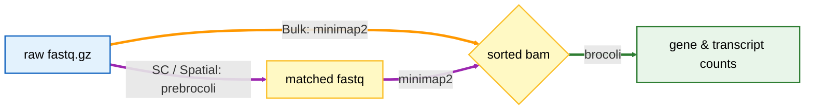

<div align="center">
  
# BroCOLI : Bron-Kerbosch calibrator of Long-read Isoform

</div>

<div align="center">
  
[](https://www.tidyverse.org/lifecycle/#stable)
[](https://github.com/gyjames/BroCOLI/graphs/contributors)
[](#installation)
[](https://en.cppreference.com/w/cpp/17)
[](https://www.gnu.org/licenses/gpl-3.0)

</div>

<div align="center">

English | [中文](./README_zh.md)

</div>

## About

BroCOLI (Bron-Kerbosch calibrator of Long-read Isoform) leverages efficient algorithms for transcript identification and quantification from long-read RNA-Seq data, supporting both bulk, single-cell and spatial applications, while maintaining low memory usage and fast performance for large-scale datasets.

The toolkit ships as **two executables**:

| Executable | Role |
| :--- | :--- |
| **`prebrocoli`** | Cell barcode and UMI extraction from raw long-read FASTQ, for single-cell and spatial libraries |
| **`brocoli`** | Isoform detection and quantification from aligned long reads — bulk, single-cell and spatial in one binary |



A typical single-cell/spatial data run is `prebrocoli` → aligner (e.g. minimap2) → `brocoli`. Bulk data goes straight to `brocoli`.

## Table of contents

- [Requirements](#requirements)
- [Installation](#🛠️Installation)
- [Quick start](#quick-start)
- [Supported chemistries](#supported-chemistries)
- [Outputs](#outputs)
- [Repository layout](#repository-layout)
- [Documentation](#documentation)
- [Reference](#reference)
- [Contact](#contact)

## 🌏Requirements

| Dependency | Notes |
| :--- | :--- |
| **C++17 compiler** | g++ 17 or later |
| **htslib** | BAM/CRAM parsing, located via `pkg-config` |
| **WFA2-lib** | gap-affine alignment, C++ bindings (`bindings/cpp/WFAligner.hpp`) |
| **edlib** | vendored — drop `edlib.h` and `edlib.cpp` into `third_party/edlib/` |
| **zlib** | gzipped FASTQ input |

All of the above are declared in `environment.yml`; the recommended route is to let conda provide them.

## 🛠️Installation

```console
git clone https://github.com/gyjames/BroCOLI.git
cd BroCOLI
```

### 🥦Option A — conda (recommended)

`setup_conda.sh` creates (or updates) the environment, runs the unit tests, and builds both executables in one shot:

```console
bash setup_conda.sh
```

```console
conda activate brocoli
./brocoli -h
./prebrocoli -h
```

### Option B — make

Inside an environment that already provides the dependencies:

```console
make check-env      # htslib / WFAligner.hpp / edlib must all report "found"
make                # builds brocoli and prebrocoli
make test           # unit tests only
```

Both routes leave the executables in the repository root.

## 🚀Quick start

Full argument lists, parameter tuning and worked examples live in the [BroCOLI Documentation](https://weiwei4396.github.io/BroCOLI/).

```console
conda activate brocoli

# 1. barcode + UMI extraction (single-cell / spatial only)
./prebrocoli -q visium -w whitelist.txt -p 16 -o demux/ reads.fastq.gz

# 2. align the demultiplexed reads with your favourite long-read aligner
minimap2 -ax splice -uf ... reference.fa demux/preBroCOLI_matched.fastq | samtools sort -o aligned.bam

# 3. isoform detection and quantification
./brocoli -h
```


## 🐋Supported chemistries

`prebrocoli -q <chemistry>`:

| Chemistry | Library | Status |
| :--- | :--- | :---: |
| `magicseq` | two- or three-segment barcode (BC8 + BC8 [+ BC8]) + UMI12 | ✅ |
| `visium` | 10x Visium spatial, BC16 + UMI12 | ✅ |
| `10x3v3` | 10x Genomics 3′ v3 | 🚧 |

🚧 = recognised on the command line but not yet implemented; the run stops with an explanatory error rather than silently returning zero barcodes.

For MAGIC-seq, select the template with `--type 2` or `--type 3`.
The barcode in whitelist column 1 must have the corresponding length:

- **16 bp (XY):** primer → BCX8 → LinkerXY → BCY8 → UMI12 → polyT10.
- **24 bp (XYZ):** primer → BCX8 → LinkerXY → BCY8 → LinkerYZ → BCZ8 → UMI12 → polyT10.

Each whitelist file must use one barcode length. Put an optional known 12 bp UMI
in column 2, separated by tabs or spaces; repeat the barcode on separate rows for
multiple UMIs. Empty lines and `#` comments are ignored. An optional first header
is recognised when column 1 is `barcode`, `barcodes`, `CellBarcode`,
`CellBarcodes`, `cell_barcode`, `cell_barcodes`, `CB`, or `BC` (case-insensitive).
Parenthesised annotations such as `Barcode (16bp)` or `Barcode(16bp)` are also
accepted. Other malformed rows still cause an error with a line number.
Barcode-only files are supported and retain the extracted UMI
without reference-based correction. A barcode length conflicting with `--type`
stops the run with the offending file and line number.

If `--type` is omitted and stdin and stderr are both terminals, an English prompt
on stderr asks for `2` or `3`; pressing Enter selects `2`. Redirecting stdout
alone keeps the prompt visible. With stdin or stderr redirected, runs (including `nohup`)
default to `2` and log that choice; use `--type 3` for XYZ. Reads must be supplied
as a file, either positionally or with `-I`; stdin reads (`-`) are not supported.
Existing XYZ scripts must add `--type 3`, including when using `-x/-y/-z`.
The selected type is checked against the whitelist; read structure is not
automatically detected or validated.

MAGIC-seq defaults to **corr+top32** for both XY and XYZ:

1. Combine the segment calls after the existing per-segment correction. If the
   corrected combination occurs in the complete whitelist, accept it without WFA.
2. Otherwise, recall candidates using the existing 9-mer index and rank them by
   posting votes across the segment-candidate combinations. Score at most 32
   candidates with WFA. Equal votes and equal WFA scores use lexical barcode order.

`--topk N` changes the WFA limit (`0` retains all candidates). `--no-corr`
disables the corrected-combination fast path. Thus `--no-corr --topk 32` uses
top32 only, and `--no-corr --topk 0` uses full-candidate WFA with deterministic
tie-breaking. This comparison mode need not be byte-identical to older builds
that resolved ties by hash iteration order. These options affect MAGIC-seq only.
The summary reports corr hits, WFA searches, candidates before truncation, and
actual WFA calls, all counted per search attempt rather than per input read.

This is an accuracy/speed tradeoff: especially with a full combinatorial
whitelist, corrected combinations can match an incorrect barcode. The speed
and accuracy figures from external experiments have not been reproduced here.
UMI extraction/correction and trimming keep their existing logic, although a
changed barcode assignment can change which UMI reference set is used.

```console
./prebrocoli -q magicseq --type 2 -w whitelist.txt -p 16 -o demux/ reads.fastq.gz

# Three-segment (XYZ) library with a 24 bp whitelist.
./prebrocoli -q magicseq --type 3 -w whitelist_xyz.txt -p 16 -o demux_xyz/ reads.fastq.gz

# Background run: defaults to XY; add --type 3 for XYZ.
nohup ./prebrocoli -q magicseq -w whitelist.txt -p 16 -o demux/ reads.fastq.gz > run.log 2>&1 &
```

`make test` includes whitelist/layout tests without WFA2. `make test-pre` runs
the full XY/XYZ extraction regressions and requires edlib and WFA2.
After building, `python3 tests/test_pre_cli.py ./prebrocoli` checks interactive
selection, the background default, whitelist conflicts, and file-only input on Linux.

## 🔥Outputs

`prebrocoli` writes data files under `--outdir`. Logs go to stdout/stderr;
interactive prompts go to stderr. Shell redirection is only needed to save logs.

| File | Contents |
| :--- | :--- |
| `<prefix>_matched.fastq` | reads with an assigned barcode, ID rewritten as `barcode_umi#readid` plus `CB:Z:` / `UB:Z:` tags |
| `<prefix>_unmatched.fastq` | reads with no barcode — only with `--keep_unmatched` |
| `<prefix>_reads_barcodes.tsv` | per-read barcode, UMI and edit distances |
| `<prefix>_barcode_counts.tsv` | barcode → read count, sorted by abundance |
| `<prefix>_summary.txt` | the same summary printed to the terminal |

## 👉🏻Repository layout

```
BroCOLI/
├── src/                  BroCOLI — discovery and quantification
├── pre/                  preBroCOLI — barcode and UMI extraction
├── tests/                unit tests
├── third_party/edlib/    edlib.h and edlib.cpp here
├── environment.yml       conda dependencies
├── setup_conda.sh        one-shot environment setup and build
├── Makefile
└── CMakeLists.txt
```

`src/` and `pre/` are two independent source trees and are compiled separately — they each have their own `main.cpp` and their own `common.hpp`, so their files must not be mixed.

## 📘Documentation

Please check out the documentation and tutorials at [BroCOLI Documentation](https://weiwei4396.github.io/BroCOLI/).

## 🏆Reference

1. Li H. Minimap2: pairwise alignment for nucleotide sequences[J]. Bioinformatics, 2018, 34(18): 3094-3100. [Minimap2](https://github.com/lh3/minimap2)
2. Santiago Marco-Sola, Juan Carlos Moure, Miquel Moreto, Antonio Espinosa. "Fast gap-affine pairwise alignment using the wavefront algorithm.". Bioinformatics, 2020. [WFA2](https://github.com/smarco/WFA2-lib)
3. Martin Šošić, Mile Šikić; Edlib: a C/C++ library for fast, exact sequence alignment using edit distance. Bioinformatics 2017 btw753. doi: 1093/bioinformatics/btw753. [Edlib](https://github.com/Martinsos/edlib)
4. O.Cheng, Flexiplex: a versatile demultiplexer and search tool for omics data, Bioinformatics, Volume 40, Issue 3, 2024. [flexiplex](https://github.com/DavidsonGroup/flexiplex)

## ✉️Contact

If you come across any issues or have suggestions, please feel free to contact Wei Pan (weipan4396@gmail.com), or open an issue if you find bugs.
